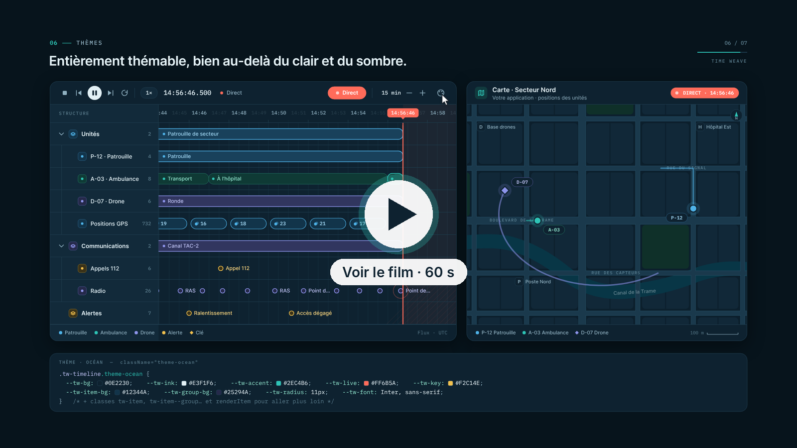
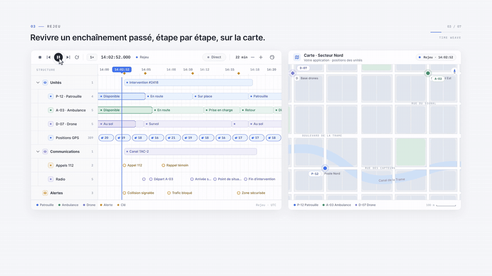

<p align="center">
  <picture>
    <source media="(prefers-color-scheme: dark)" srcset="docs/assets/logo-dark.svg">
    
  </picture>
</p>

<p align="center"><strong>Des timelines interactives qui restent synchronisées avec votre application.</strong><br>
TypeScript · React 18.3 et 19 · licence MIT</p>

<p align="center">
  <a href="https://alexandre-plana.github.io/time-weave/">Démo en ligne</a> ·
  <a href="docs/GUIDE.md">Guide d'utilisation</a> ·
  <a href="docs/en/README.md">English</a> ·
  <a href="motion/out/time-weave-demo.mp4">Film de présentation</a>
</p>

---

Time Weave affiche plusieurs lignes hiérarchiques sur un axe du temps, de la milliseconde aux décennies. Son curseur pilote le reste de votre interface : carte, tableau de bord, vidéo, journal… La lecture **attend que votre application soit prête** avant de confirmer un instant, si bien que la timeline et l'écran ne se désynchronisent jamais, que l'on rejoue le passé ou que l'on suive le Direct.

## Le film

<!-- LECTEUR VIDÉO : remplacer l'image ci-dessous par l'adresse https://github.com/user-attachments/assets/… obtenue en déposant motion/out/time-weave-demo-web.mp4 sur GitHub. -->
[](motion/out/time-weave-demo.mp4)

Le film dure 60 secondes, en 1080p à 60 i/s, avec une bande-son. Il est découpé en sept chapitres : hiérarchie, échelles, **rejeu**, synchronisation, Direct, **thèmes**, clavier. Sa note d'intention et son découpage se trouvent dans [`motion/`](motion/README.md). Il est entièrement généré par le code de ce dépôt.

## Rejouer une situation passée



L'usage pour lequel Time Weave a été conçu, c'est **revivre un enchaînement passé**. On rejoue une journée d'opérations ou une intervention, on saute d'une étape clé à la suivante, et on boucle sur la période. À chaque instant, l'application montre l'état correspondant : ici, les positions et les traces des unités sur une carte.

## Ce que fait la bibliothèque

| | |
| --- | --- |
| **Lignes hiérarchiques** | Lignes dépliables sur plusieurs niveaux, libellés et contenus personnalisables, limitation au visible. |
| **Toutes les échelles** | Temps calendrier (UTC) ou relatif (`0 ms`), zoom et déplacement libres de la milliseconde aux décennies, graduations adaptées. |
| **Lecture** | Lecture, pause, arrêt, vitesse, clé précédente/suivante, boucle sur la période complète, saut à un instant. |
| **Synchronisation** | Contrat `prepareTime(request)` : la timeline montre une cible en attente (pointillés) et ne confirme le curseur que lorsque l'application est prête. Les requêtes périmées sont annulées par `request.signal`. |
| **Données par fenêtre** | Sources en mémoire ou par fenêtre temporelle, remplaçables au zoom. Le regroupement reste à l'application, qui fournit des éléments individuels ou groupés. |
| **Direct** | Suivi de la dernière position fournie par l'application, retour dans l'historique puis retour au Direct. Collections modifiables pendant l'utilisation. |
| **Accessibilité** | Curseur `role="slider"`, navigation au clavier dans les éléments, fenêtre de détail en portail avec arrière-plan `inert`, contrastes vérifiés, textes français et anglais. |
| **Moteur séparé** | `@time-weave/react/core` fonctionne sans React ni DOM et reste testable sur une horloge contrôlée. |

## Démarrage

Le paquet `@time-weave/react` n'est pas encore publié sur npm. Pour l'essayer depuis ce dépôt :

```bash
npm install
npm run dev:examples  # exemples : http://localhost:5173/
npm test              # règles du moteur (horloge contrôlée) et composants React (jsdom)
npm run check         # typage, tests, build, isolation du moteur, archive installée, exemples
```

Pour l'utiliser dans une autre application, lancez `npm pack` ici, puis `npm install chemin/vers/time-weave-react-0.1.0.tgz`.

```tsx
import { PlaybackControls, Timeline, useTimelineController } from '@time-weave/react';
import '@time-weave/react/styles.css';

const controller = useTimelineController({
  mode: 'calendar',
  domain: { start: Date.UTC(2026, 9, 18), end: Date.UTC(2026, 9, 19) },
  rows: [{ id: 'station', label: 'Station Nord' }],
  source: [{ id: 'm1', rowId: 'station', at: Date.UTC(2026, 9, 18, 6), label: 'Mesure' }],
  // La timeline attend cette promesse avant de confirmer l'instant demandé.
  prepareTime: (request) => application.afficherEtatA(request.target, request.signal),
});

<Timeline controller={controller} toolbar={<PlaybackControls controller={controller} showLive />} />;
```

Le [guide d'utilisation](docs/GUIDE.md) décrit l'API complète : points d'entrée, temps, sources, préparation, commandes, Direct, clavier et styles.

## Thèmes

Le thème clair et le thème sombre (prop `theme`, ou `prefers-color-scheme`) ne sont que deux exemples : toute l'apparence passe par des variables CSS `--tw-*`, que l'on cible avec la prop `className`.

```css
.tw-timeline.theme-ocean {
  --tw-bg: #0e2230;      --tw-ink: #e3f1f6;     --tw-accent: #2ec4b6;
  --tw-live: #ff6b5a;    --tw-key: #f2c14e;     --tw-item-bg: #12344a;
  --tw-radius: 11px;     --tw-font: Inter, sans-serif;
}
```

```tsx
<Timeline controller={controller} className="theme-ocean" />
```

Les variables couvrent les couleurs, les éléments, les groupes, les clés, le Direct, le rayon, les polices, la hauteur de l'axe et la largeur des libellés. La fenêtre de détail est rendue dans `document.body` : il faut y redéfinir les mêmes variables (`.tw-modal-backdrop`). Pour aller plus loin, il y a les classes `tw-item`, `tw-item--group`… ainsi que `getItemClassName`, `renderItem` et `renderRowLabel`. Le film montre quatre thèmes : Clair, Sombre, Océan et Papier.

## Premiers usages

- **Rejouer une journée d'opérations** : parcourir des communications de capteurs et piloter les autres éléments d'une application à partir du temps de lecture.
- **Surveiller un flux** : mettre à jour les collections pendant l'utilisation et suivre le Direct, avec possibilité de revenir à l'historique.
- **Présenter l'histoire d'une entreprise** : explorer des événements et des périodes sur plusieurs années ou décennies.

Les [exemples](examples/README.md) illustrent chacun de ces cas, ainsi qu'un banc d'essai en temps relatif et une page de mesure.

## Documentation

| Document | Contenu |
| --- | --- |
| [Guide d'utilisation](docs/GUIDE.md) · [English guide](docs/en/GUIDE.md) | API, exemples de code, clavier, styles |
| [Architecture](docs/ARCHITECTURE.md) | Séparation du moteur, de la vue React et des aides |
| [Conception V1](docs/CONCEPTION-V1.md) | Comportements, données, synchronisation, critères de réalisation |
| [Définition](docs/DEFINITION.md) | Besoins confirmés et limites de responsabilité |
| [Plan de réalisation](docs/PLAN-REALISATION.md) | Outillage, étapes et journal |
| [Mesures](docs/MESURES.md) · [Jeu de référence](docs/JEU-REFERENCE.md) | Performances et scénarios de mesure |
| [Questions ouvertes](docs/QUESTIONS-OUVERTES.md) · [Revue extérieure](docs/REVUE-V1.md) | Décisions restantes, regard critique |
| [Journal des versions](CHANGELOG.md) | Évolutions |

## Organisation du dépôt

| Dossier | Contenu |
| --- | --- |
| `src/core/` | Moteur : modèle, validation, hiérarchie, clés, graduations, pistes, ordonnanceurs, contrôleur |
| `src/react/` | `Timeline`, `PlaybackControls`, `DetailModal`, hooks, textes anglais et français |
| `src/styles.css` | Styles par défaut, variables `--tw-*`, thème sombre |
| `tests/`, `e2e/` | Tests Vitest du moteur et des composants, tests de bout en bout Playwright |
| `examples/` | Accueil, journée d'opérations, histoire d'entreprise, temps relatif, page de mesure |
| `scripts/` | Isolation du moteur, archive installée, vérification React 18.3, mesures |
| `motion/` | Film de présentation : scène Canvas déterministe, rendu, bande-son synthétisée, logo |
| `docs/assets/` | Logo (SVG clair, sombre, symbole), aperçus du film |
| `mockups/` | Explorations visuelles qui ont guidé la présentation ([comparateur](mockups/propositions.html)) |

## État du projet

**31 octobre 2026 : première implémentation V1** de la [conception validée](docs/CONCEPTION-V1.md) le 18 octobre. Décisions de publication :

- nom du paquet : `@time-weave/react` (l'organisation npm `time-weave` reste à créer) ;
- licence [MIT](LICENSE) ;
- React 18.3 et 19, vérifiés en CI ;
- versions `0.x` jusqu'au premier retour d'usage.

Aucune publication npm n'a encore été faite. Prochaines étapes : mesures sur un poste réel (`npm run bench -- --headed`), utilisation dans une première application, puis publication en `0.x`.

## Licence

[MIT](LICENSE). Les polices Inter et IBM Plex Mono incluses dans `motion/fonts/` sont distribuées sous licence SIL OFL 1.1.
