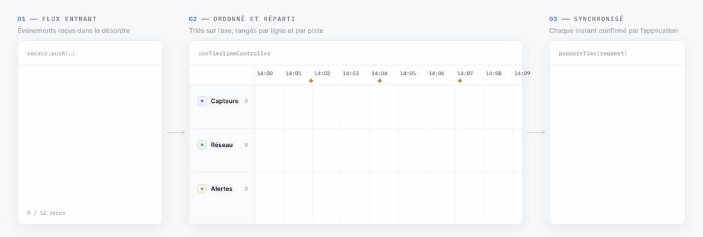
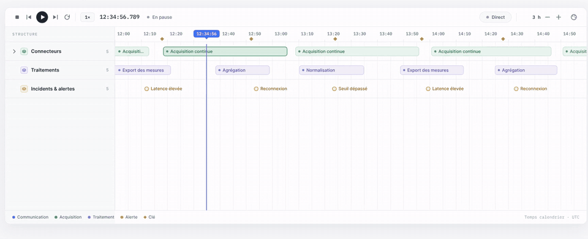
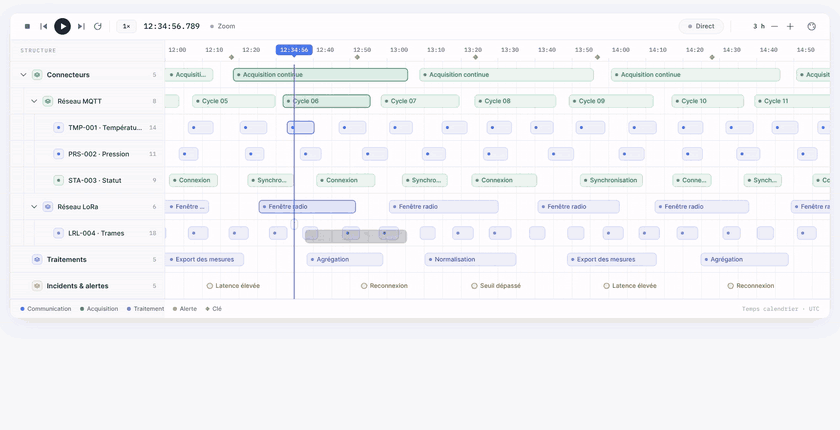
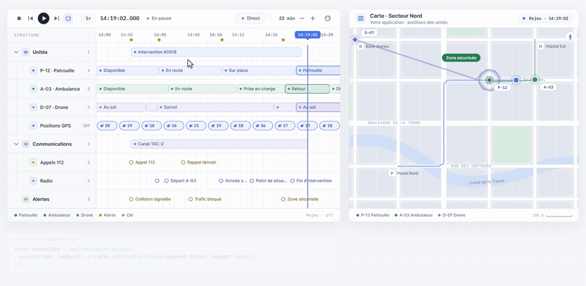
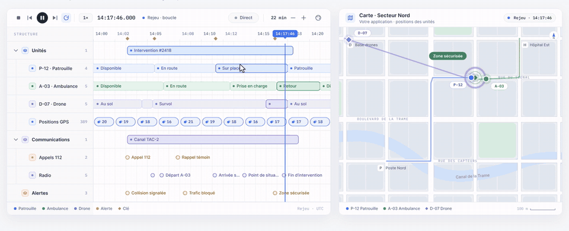
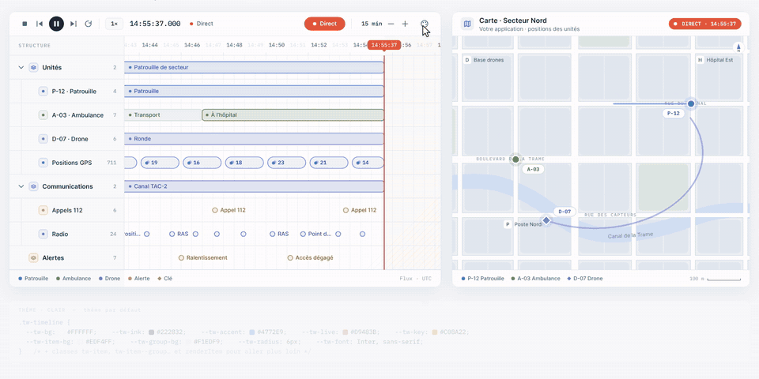
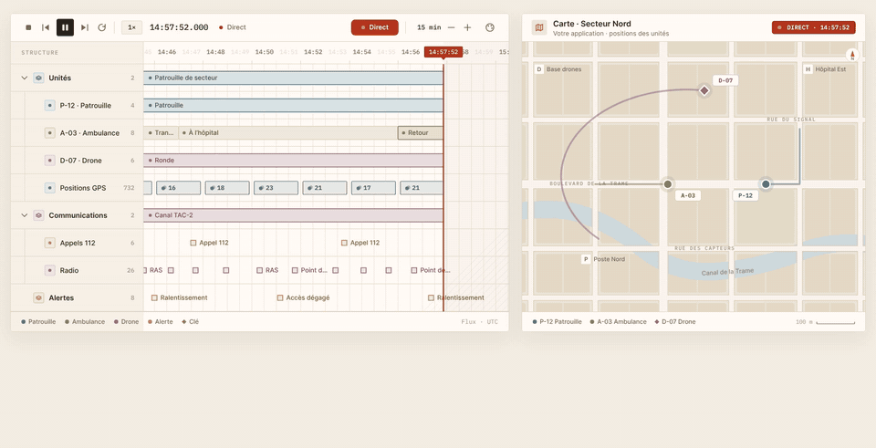

<p align="center">
  <picture>
    <source media="(prefers-color-scheme: dark)" srcset="docs/assets/logo-dark.svg">
    
  </picture>
</p>

<h3 align="center">Des timelines interactives qui restent synchronisées avec votre application.</h3>

<p align="center">
  <a href="https://github.com/alexandre-plana/time-weave/actions/workflows/ci.yml"></a>
  <a href="LICENSE"></a>
  
  
  
</p>

<p align="center">
  <a href="https://alexandre-plana.github.io/time-weave/"><b>Démo en ligne</b></a> ·
  <a href="docs/GUIDE.md">Guide</a> ·
  <a href="docs/en/README.md">English</a> ·
  <a href="examples/README.md">Exemples</a> ·
  <a href="CHANGELOG.md">Journal des versions</a>
</p>

<br>

https://github.com/user-attachments/assets/902d3060-0dcb-45dd-8415-b2aee7ceac4d

<p align="center"><sub>Film de présentation · 60 s · généré par le code de ce dépôt (<a href="motion/README.md">note d'intention</a>)</sub></p>

## Pourquoi Time Weave

<table>
  <tr>
    <td width="33%" valign="top"><b>Le temps reste partagé</b><br>Le curseur pilote votre interface (carte, tableau de bord, vidéo, journal) et n'est confirmé que lorsque l'application a fini de se préparer. Fini les écrans en décalage.</td>
    <td width="33%" valign="top"><b>De la milliseconde aux décennies</b><br>Un seul composant pour une rafale de capteurs, une journée d'opérations ou l'histoire d'une entreprise, en temps calendrier ou relatif.</td>
    <td width="33%" valign="top"><b>Rejouer, suivre, comprendre</b><br>Rejeu à vitesse choisie, sauts entre étapes clés, boucle, mode Direct et retour à l'historique, avec un moteur testable sans React.</td>
  </tr>
</table>

## Comment ça marche

<p align="center"></p>

1. **Flux entrant.** L'application fournit ses éléments, en mémoire ou par fenêtre temporelle, dans n'importe quel ordre et à n'importe quel moment.
2. **Ordonné et réparti.** Le moteur les valide, les place sur l'axe, les range par ligne et les empile en pistes quand ils se chevauchent. Les clés servent de repères de navigation.
3. **Synchronisé.** À chaque instant demandé (lecture, clic, clavier, Direct), `prepareTime(request)` laisse l'application se mettre à jour. Le curseur n'est confirmé qu'une fois la promesse résolue, et les requêtes périmées sont annulées par `request.signal`.

## En images

<table>
  <tr>
    <td width="50%" valign="top">
      <b>Hiérarchie dépliable</b><br><sub>Lignes sur plusieurs niveaux, libellés et contenus personnalisables, limitation au visible.</sub><br><br>
      
    </td>
    <td width="50%" valign="top">
      <b>Toutes les échelles</b><br><sub>Zoom continu de 23 ms à 46 ans ; l'application fournit des groupes avec compteur selon le zoom.</sub><br><br>
      
    </td>
  </tr>
  <tr>
    <td colspan="2" valign="top">
      <b>Rejeu d'une situation passée</b><br><sub>Lecture, sauts entre étapes clés et boucle. La carte de l'application suit le curseur : positions, traces, état de l'incident.</sub><br><br>
      
    </td>
  </tr>
  <tr>
    <td width="50%" valign="top">
      <b>Synchronisation</b><br><sub>Ligne d'attente en pointillés pendant que l'application charge, puis confirmation simultanée.</sub><br><br>
      
    </td>
    <td width="50%" valign="top">
      <b>Mode Direct</b><br><sub>Frontière rouge suivie en continu, retour dans l'historique, puis « Revenir au Direct ».</sub><br><br>
      
    </td>
  </tr>
  <tr>
    <td width="50%" valign="top">
      <b>Entièrement thémable</b><br><sub>Variables <code>--tw-*</code> et <code>className</code> : couleurs, rayons, polices, bien au-delà du clair et du sombre.</sub><br><br>
      
    </td>
    <td width="50%" valign="top">
      <b>Clavier et accessibilité</b><br><sub>Curseur <code>role="slider"</code>, navigation dans les éléments, fenêtre de détail en portail avec arrière-plan <code>inert</code>.</sub><br><br>
      
    </td>
  </tr>
</table>

## Démarrage rapide

> Le paquet `@time-weave/react` n'est pas encore publié sur npm. En attendant, créez l'archive depuis ce dépôt avec `npm pack`, puis installez-la : `npm install chemin/vers/time-weave-react-0.1.0.tgz`.

```tsx
import { PlaybackControls, Timeline, useTimelineController } from '@time-weave/react';
import '@time-weave/react/styles.css';

export function Rejeu() {
  const controller = useTimelineController({
    mode: 'calendar',
    domain: { start: Date.UTC(2026, 9, 18), end: Date.UTC(2026, 9, 19) },
    rows: [{ id: 'station', label: 'Station Nord' }],
    source: [{ id: 'm1', rowId: 'station', at: Date.UTC(2026, 9, 18, 6), label: 'Mesure' }],
    // La timeline attend cette promesse avant de confirmer l'instant demandé.
    prepareTime: (request) => application.afficherEtatA(request.target, request.signal),
  });

  return <Timeline controller={controller} toolbar={<PlaybackControls controller={controller} showLive />} />;
}
```

Pour travailler sur la bibliothèque :

```bash
npm install
npm run dev:examples  # exemples sur http://localhost:5173/
npm test              # moteur (horloge contrôlée) et composants React (jsdom)
npm run check         # typage, tests, build, isolation du moteur, archive installée, e2e
```

## API en bref

| Élément | Rôle |
| --- | --- |
| `useTimelineController(options)` | Crée le contrôleur : période, lignes, source, clés, `prepareTime`, Direct |
| `<Timeline>` | Vue : axe, lignes, éléments, curseur, zoom et déplacement ; `highlights` pour colorer des périodes sur toutes les lignes |
| `<PlaybackControls>` | Lecture, pause, arrêt, vitesse, clés, boucle, Direct |
| `<TimelineOverview>` | Vue d'ensemble : densité, clés, curseur, fenêtre visible déplaçable et redimensionnable |
| `<DetailModal>` | Fenêtre de détail accessible, utilisable seule |
| `useTimelineSelector(controller, selector)` | Ne rend le composant que lorsque la valeur choisie change |
| `controller.play()`, `seek(t)`, `nextKey()`, `zoomTo(d)`, `centerOn(t)`, `stepBy(d)`, `fitToItems()`, `goLive()`… | Commandes, aussi utilisables depuis l'application |
| `@time-weave/react/core` | Moteur seul, sans React ni DOM |

Le [guide d'utilisation](docs/GUIDE.md) détaille chaque option, le contrat de préparation, les sources par fenêtre, le clavier et les styles.

## Thèmes

Toute l'apparence passe par des variables CSS `--tw-*`. Le clair et le sombre (prop `theme` ou `prefers-color-scheme`) sont deux thèmes parmi d'autres :

```css
.tw-timeline.theme-ocean {
  --tw-bg: #0e2230;    --tw-ink: #e3f1f6;   --tw-accent: #2ec4b6;
  --tw-live: #ff6b5a;  --tw-key: #f2c14e;   --tw-item-bg: #12344a;
  --tw-radius: 11px;   --tw-font: Inter, sans-serif;
}
```

```tsx
<Timeline controller={controller} className="theme-ocean" />
```

<details>
<summary>Aller plus loin</summary>

- Les variables couvrent les couleurs, les éléments, les groupes, les clés, le Direct, les bandes (`--tw-highlight-*`), le rayon, les polices, la hauteur de l'axe et la largeur des libellés.
- La fenêtre de détail est rendue dans `document.body` : il faut y redéfinir les mêmes variables (`.tw-modal-backdrop`).
- Les classes `tw-item`, `tw-item--group`, `tw-item--active`…, ainsi que `getItemClassName`, `renderItem` et `renderRowLabel`, permettent d'adapter le rendu élément par élément.

</details>

## Exemples

| Exemple | Ce qu'il montre |
| --- | --- |
| **Journée d'opérations** | 211 lignes, source par fenêtre, regroupement selon le zoom, `prepareTime` qui attend les données, flux simulé et Direct |
| **Histoire d'entreprise** | 75 ans de périodes et de jalons, contenu personnalisé, lecture à quatre ans par seconde |
| **Temps relatif** | Séquence de −2 s à 12 s autour d'un déclenchement, mesures à la milliseconde |
| **Banc de mesure** | Scénarios du [jeu de référence](docs/JEU-REFERENCE.md), résultats dans [MESURES.md](docs/MESURES.md) |

Lancez-les avec `npm run dev:examples`, ou ouvrez la [démo en ligne](https://alexandre-plana.github.io/time-weave/).

## Documentation

| | |
| --- | --- |
| [Guide d'utilisation](docs/GUIDE.md) · [English guide](docs/en/GUIDE.md) | API, exemples de code, clavier, styles |
| [Architecture](docs/ARCHITECTURE.md) | Séparation du moteur, de la vue React et des aides |
| [Conception V1](docs/CONCEPTION-V1.md) · [Définition](docs/DEFINITION.md) | Comportements, données, synchronisation, limites de responsabilité |
| [Plan de réalisation](docs/PLAN-REALISATION.md) · [Mesures](docs/MESURES.md) | Étapes, journal et performances |
| [Questions ouvertes](docs/QUESTIONS-OUVERTES.md) · [Revue extérieure](docs/REVUE-V1.md) | Décisions restantes, regard critique |

<details>
<summary>Organisation du dépôt</summary>

| Dossier | Contenu |
| --- | --- |
| `src/core/` | Moteur : modèle, validation, hiérarchie, clés, graduations, pistes, ordonnanceurs, contrôleur |
| `src/react/` | `Timeline`, `TimelineOverview`, `PlaybackControls`, `DetailModal`, hooks, textes anglais et français |
| `src/styles.css` | Styles par défaut, variables `--tw-*`, thème sombre |
| `tests/`, `e2e/` | Tests Vitest du moteur et des composants, tests de bout en bout Playwright |
| `examples/` | Accueil, opérations, histoire d'entreprise, temps relatif, page de mesure |
| `scripts/` | Isolation du moteur, archive installée, vérification React 18.3, mesures |
| `motion/` | Film et animations du README : scènes Canvas déterministes, bande-son synthétisée, logo |
| `docs/assets/` | Logo (SVG), GIF du README |
| `mockups/` | Explorations visuelles qui ont guidé la présentation |

</details>

## État du projet

**Première implémentation V1** (31 octobre 2026) de la [conception validée](docs/CONCEPTION-V1.md). Paquet `@time-weave/react`, licence MIT, React 18.3 et 19 vérifiés en CI, versions `0.x` jusqu'au premier retour d'usage. Aucune publication npm n'a encore été faite.

**Prochaines étapes :** mesures sur un poste réel (`npm run bench -- --headed`), utilisation dans une première application, création de l'organisation npm `time-weave`, puis publication en `0.x`.

## Licence

[MIT](LICENSE) © 2026 Time Weave contributors. Les polices Inter et IBM Plex Mono incluses dans `motion/fonts/` sont distribuées sous licence SIL OFL 1.1.
