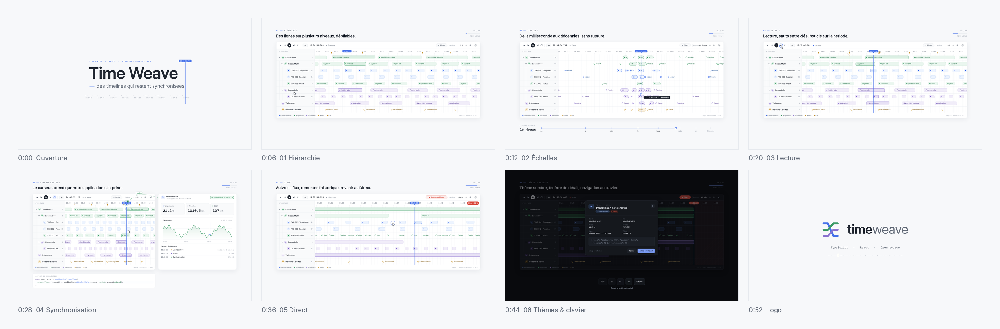

# Time Weave — film de démonstration (60 s)

Film de motion design pour présenter Time Weave : 60 secondes, 1920 × 1080, 60 i/s, avec une bande-son électronique minimale.



- Vidéo : [`out/time-weave-demo.mp4`](out/time-weave-demo.mp4) (17,8 Mo) · version web [`out/time-weave-demo-web.mp4`](out/time-weave-demo-web.mp4) (8,7 Mo, sous la limite d'envoi de GitHub)
- Prévisualisation interactive : ouvrir `index.html` (Espace pour lire ou mettre en pause, curseur pour se déplacer)

## Note d'intention

Le film ne dit qu'une chose : **le temps reste partagé**. Un seul trait bleu, le curseur, sert de fil conducteur du début à la fin. Il se dessine, révèle le titre, devient le curseur de la timeline, pilote la carte de l'application, devient rouge en Direct, sert de volet entre les thèmes et finit en logo.

Le film suit trois axes :

1. **La timeline elle-même** : hiérarchie dépliable, zoom continu de la milliseconde aux décennies, regroupement des éléments.
2. **Le rejeu** : revivre une situation passée, étape par étape. Une intervention (appel, engagement des unités, arrivée sur place, zone sécurisée) est rejouée sur une carte. Les positions et les traces des unités suivent le curseur, que l'on lise, saute entre les clés ou boucle sur la période. Cet axe reprend le premier usage du projet (`docs/DEFINITION.md`, « Rejeu d'une journée d'opérations »).
3. **L'intégration** : synchronisation avec l'application (`prepareTime`), Direct, thèmes entièrement personnalisables (bien au-delà du clair et du sombre), clavier et fenêtre de détail.

Le style est éditorial : beaucoup d'air, des panneaux posés sur un fond `#F7F8FA`, des filets de 1 px `#E6E9EE`, une légende de chapitre en haut à gauche (numéro en Plex Mono et phrase-titre en Inter) et un folio en haut à droite. Les mouvements décélèrent (`outCubic`, `outQuart`, `outExpo`), les changements de cadre utilisent `inOutCubic`, et la caméra zoome de façon logarithmique.

## Découpage

| Temps | Séquence | Ce que l'on voit | Son |
| --- | --- | --- | --- |
| 0:00 – 0:06 | **Ouverture** | Le trait bleu se dessine, sa poignée défile jusqu'à `12:34:56.789`, il révèle « Time Weave — des timelines qui restent synchronisées ». | Nappe en la mineur 9, tics de graduation, cloche |
| 0:06 – 0:12 | **01 Hiérarchie** | Recul de caméra ×7 → ×1 : le trait devient le curseur. Le pointeur déplie Connecteurs, MQTT, LoRa. | Souffle, sub, le kick entre à 0:08 |
| 0:12 – 0:20 | **02 Échelles** | Ctrl + molette : plongée jusqu'à 23 ms, puis zoom arrière jusqu'à 46 ans. Les éléments se regroupent en pastilles avec compteur, une échelle « ms → décennie » suit la fenêtre visible. | Une tonalité suit l'échelle du zoom |
| 0:20 – 0:30 | **03 Rejeu** | Le zoom revient sur une intervention passée (14:00 → 14:22), les lignes basculent sur la flotte (unités, positions GPS groupées, appels, radio, alertes) et une **carte** apparaît. Lecture, trois sauts entre clés (« Unités engagées », « Arrivée sur place », « Zone sécurisée »), boucle et ×3 : les unités parcourent les rues avec leur trace, le lieu de l'incident pulse puis passe au vert. | Cloches sur les clés, arpège sur la boucle |
| 0:30 – 0:37 | **04 Synchronisation** | Un clic place une ligne d'attente en pointillés. La requête `prepareTime(request)` part vers la carte, qui affiche « Chargement des positions… », puis le curseur et les positions se confirment ensemble. Une deuxième attente intervient pendant la lecture. Le contrat de code est affiché. | Tic-tac d'attente, carillon |
| 0:37 – 0:44 | **05 Direct** | La frontière rouge avance et les unités se déplacent en direct sur la carte. Glissement vers l'historique (pastille « Direct +11 ») : la carte affiche les positions passées. Puis « Revenir au Direct ». | Impact grave, notes d'arrivée, frottement |
| 0:44 – 0:48,6 | **06 Thèmes** | Trois volets successifs : Clair → Sombre → **Océan** → **Papier**. Couleurs, rayons et carte changent ensemble, et une carte de code montre les variables `--tw-*` du thème courant (sélecteur, `className`, valeurs). | Souffle et cloche à chaque thème |
| 0:48,6 – 0:53 | **07 Clavier** | En thème Papier : `Tab`, `←`, `←` avec anneau de focus ; la carte repère la position du message radio ciblé. `Entrée` ouvre la fenêtre de détail (heure, unité, position GPS), puis `Tab` et `Échap`. | Clics de touches, « pop » de fenêtre |
| 0:53 – 1:00 | **Logo** | Les lignes se replient et le film revient au clair. Le trait se résout en trois brins tissés, puis apparaissent `timeweave` et **TypeScript · React · Open source**. | Accord final en do majeur 9 |

## Thèmes

La bibliothèque se thème par les variables CSS `--tw-*` posées sur `.tw-timeline`, que l'on peut cibler avec la prop `className` : couleurs, éléments, groupes, clés, Direct, rayon, polices, hauteur d'axe, largeur des libellés. Les classes `tw-item`, `tw-item--group`… et `renderItem` / `renderRowLabel` permettent d'aller plus loin. Le film montre quatre thèmes :

| Thème | Sélecteur | Fond | Accent | Direct | Rayon |
| --- | --- | --- | --- | --- | --- |
| Clair | `.tw-timeline` | `#FFFFFF` | `#4772E9` | `#D9483B` | 6 px |
| Sombre | `.tw-timeline[data-theme='dark']` | `#15181D` | `#7B9CF5` | `#E5574A` | 6 px |
| Océan | `.tw-timeline.theme-ocean` | `#0E2230` | `#2EC4B6` | `#FF6B5A` | 11 px |
| Papier | `.tw-timeline.theme-papier` | `#FFFCF6` | `#C2532F` | `#A8231B` | 2 px |

La carte de démonstration (qui appartient à l'application, pas à la bibliothèque) suit les mêmes jetons.

## Système graphique (thème clair)

| Rôle | Valeur |
| --- | --- |
| Fond | `#F7F8FA` |
| Panneaux | `#FFFFFF`, rayon 14 px, ombre très diffuse |
| Filets | `#E6E9EE`, 1 px |
| Curseur | `#4772E9` |
| Direct | `#D9483B` |
| Pastilles | bleu, vert, ambre, violet : fond teinté, bord plus soutenu, texte foncé |
| Clés | losanges ambre `#C08A22` |
| Typographie | Inter 400/500/600 ; IBM Plex Mono 400/500/600 pour les horodatages, les valeurs et le code |

## Musique

Le morceau est entièrement synthétisé par `music.py` avec numpy, sans échantillon : 120 BPM, une mesure = 2 s. La grille harmonique est la mineur 9, fa majeur 9, do majeur 9, sol 6, ré mineur 9 et mi mineur 7, et se résout en do majeur 9 sur le logo. Le morceau combine un pad additif, un kick doux avec compression latérale, une charleston en contretemps, une basse et des arpèges pincés en écho, dans une réverbération à convolution. Les effets sont calés à l'image près sur les repères exportés par la scène (`out/cues.json`). Le niveau intégré est d'environ −14 LUFS et la crête à −1 dBFS.

## Fabrication

Toute l'image est une fonction pure du temps, `TW.render(ctx, t)` dans `scene.js` (Canvas 2D). Le rendu est donc déterministe image par image.

```bash
cd motion
node render.cjs cues                       # repères sonores → out/cues.json
python3 music.py                           # bande-son → out/music.wav
node render.cjs video 60                   # 3 600 images → out/time-weave-demo.mp4 (H.264 + AAC)
node render.cjs stills 2,24,46,50 out/img  # images de contrôle
python3 logo.py                            # logo SVG → docs/assets/ (nécessite fonttools)
node render-anim.cjs flow.html ../docs/assets/flux.gif 9 15 1100   # animation « flux ordonné » du README
```

Il faut Node 18 ou plus, Playwright avec Chromium, ffmpeg (libx264), ainsi que Python 3 et numpy. Les polices Inter et IBM Plex Mono sont incluses dans `fonts/` (licence SIL OFL 1.1). Toutes les données affichées (opérations, intervention, unités, positions) sont fictives.
